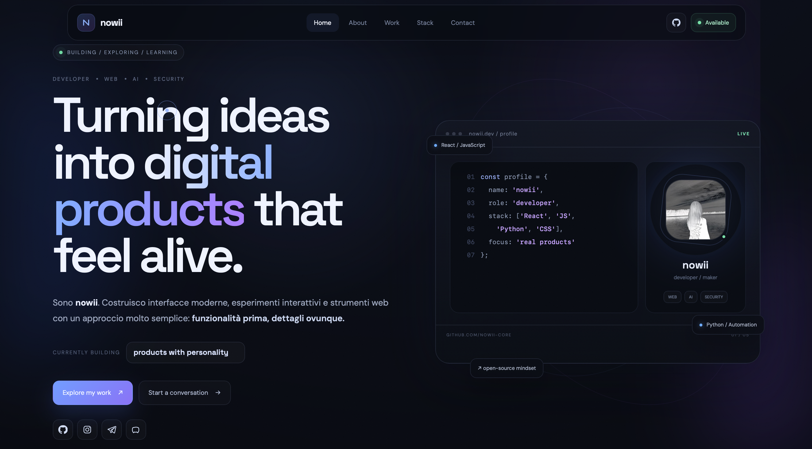

# nowii — Personal Portfolio

<p align="center">
  <b>Creative Developer · Web · AI · Cybersecurity. A Personal Interactive Portfolio Showcase Built with Modern Web Technologies.</b>
</p>

<p align="center">
  <a href="https://github.com/nowii-core/portfoglio/blob/main/LICENSE">
    
  </a>
  
  
  
  
  
  
  
</p>

<p align="center">
  <a href="#-overview">Overview</a> •
  <a href="#-key-features">Features</a> •
  <a href="#-tech-stack">Tech Stack</a> •
  <a href="#-project-architecture">Architecture</a> •
  <a href="#-quick-start">Quick Start</a> •
  <a href="#-contact">Contact</a>
</p>

---

</div>

## Overview

**nowii** is a personal interactive portfolio designed to present my work, skills, experiments, and projects through a modern digital experience. 

The website is built with a strong focus on visual quality, motion design, responsive layout, and interactive details, with the goal of making the first impression immediate and memorable. It combines web development, creative interfaces, experimentation with AI, and a growing focus on cybersecurity.

> *Build. Experiment. Learn. Improve.*

---

## Preview



> **Live Demo:** [nowii-core.github.io/portfoglio/nowii-portfolio/](https://nowii-core.github.io/portfoglio/nowii-portfolio/)

---

## Key Features

- **Animated Introduction:** A cinematic opening sequence featuring a logo, loading progress, and smooth entrance animations.
- **Dynamic Hero Section:** Rotating descriptions that automatically transition between different areas of development and technology.
- **Interactive Project Showcase:** Project cards with visual previews, hover effects, associated technologies, and direct links.
- **Infinite Tech Marquee:** A continuously scrolling technology strip for a dynamic visual presentation.
- **Fully Responsive Design:** Optimized for desktop, tablet, and mobile viewing experiences.
- **Motion & Micro-interactions:** Engaging scroll reveals, custom cursor effects, 3D tilt interactions, and smooth transitions.
- **Modern Social Section:** Direct, accessible links to GitHub, Instagram, Telegram, and Discord.
- **Performance-focused Structure:** A lightweight frontend architecture without unnecessary framework overhead, ensuring fast load times.

---

## Tech Stack

### Frontend
- **HTML5:** Semantic page structure and accessible markup.
- **CSS3:** Modern layouts utilizing Flexbox, Grid, responsive design principles, transitions, and custom animations.
- **JavaScript (ES6+):** Dynamic content rendering, interaction logic, and UI animations.
- **React:** Used for modern component-based web application development and interactive experiments.

### Backend & Tools
- **Python:** Scripting, automation, experiments, and development utilities.
- **Node.js:** JavaScript runtime for tooling, API development, and application logic.
- **Git & Linux:** Version control and primary development/cybersecurity lab environment.

### Areas of Interest
Web Development • AI & Automation • Cybersecurity • UI / UX • Creative Development • Interactive Experiences.

---

## Project Architecture

```
nowii-portfolio/
├── index.html       # Main structure and content of the portfolio
├── styles.css       # Complete visual system, responsive layout and animations
├── script.js        # Interactions, dynamic text, scroll animations and UI effects
└── README.md        # Project documentation
```

---

## Design Philosophy

The portfolio follows a **dark, modern, and technology-focused visual identity**. The interface combines deep dark backgrounds, blue/violet light accents, glassmorphism-inspired surfaces, animated gradients, subtle glow effects, smooth typography transitions, and interactive cards.

The objective is not to overload the interface with effects, but to use animation strategically to improve hierarchy, personality, and user experience.

---

## Quick Start

### Prerequisites
No complex installation or build steps are required. The project is built as a lightweight static website.

### Installation

1. **Clone the repository:**
   ```bash
   git clone https://github.com/nowii-core/portfoglio.git
   cd portfoglio/nowii-portfolio
   ```

2. **Run the application:**
   You can open the `index.html` file directly in your browser. Alternatively, for a local development server, run:
   ```bash
   python3 -m http.server 5500
   ```
   Then navigate to `http://127.0.0.1:5500` in your web browser.

---

## Contact & Support

- **Maintainer:** [@nowii-core](https://github.com/nowii-core)
- **Telegram:** [@nolxv3](https://t.me/nolxv3)
- **Discord:** `@nxvibe`
- **Reddit:** [u/nowii-core](https://www.reddit.com/user/nowii-core/)
- **Twitter:** [@nowiicore](https://twitter.com/nowiicore)
- **Bug Reports & Feature Requests:** Open an [Issue](https://github.com/nowii-core/portfoglio/issues) or submit a [Pull Request](https://github.com/nowii-core/portfoglio/pulls).

---

## License

This project is distributed under the **MIT** license. See the [`LICENSE`](./LICENSE) file for more information.

---

<div align="center">
  <sub>Developed by <b>nowii-core</b></sub>
</div>
